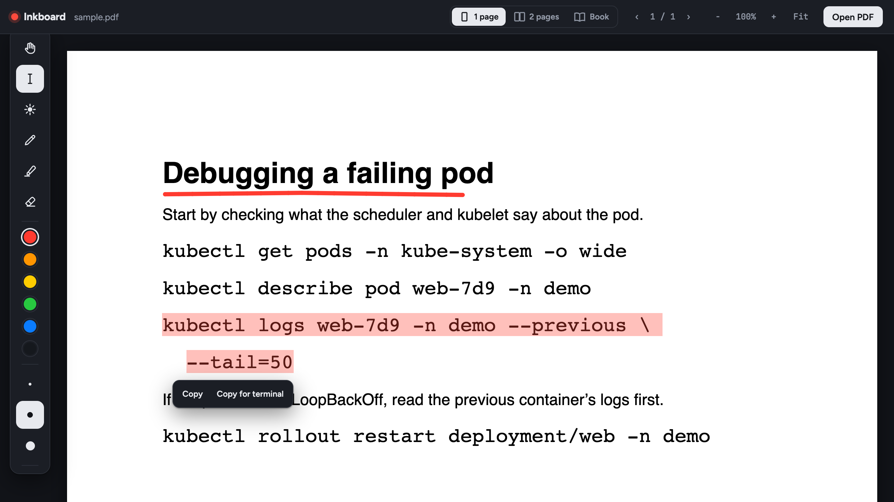

<div align="center">

# Inkboard

**Write on PDFs while you screen-record or teach.** Laser pointer, pen, highlighter and disappearing ink, right in the browser. No account, no upload, no install.

[](https://github.com/bhavukbhardwaj/inkboard/actions/workflows/ci.yml)
[](https://github.com/bhavukbhardwaj/inkboard/releases)
[](LICENSE)
[](#run-it)



</div>

## Why Inkboard

Explaining a document on camera usually means paying for a screen-annotation tool, or settling for a viewer that has no live pen or pointer. macOS Preview, for example, cannot draw while you present.

Inkboard is a small, free alternative for:

- **Teachers and trainers** who walk through slides, worksheets and textbooks on a call or a recording.
- **Engineers and technical writers** who explain runbooks, architecture PDFs and study material, and need to copy commands out of them.
- **Students and course creators** who record explainers.

Your PDF never leaves your computer, and the app works offline.

## Features

- **Laser pointer**: a glowing dot that follows your stylus or mouse, with a short fading trail.
- **Pen**: pressure-sensitive ink with a stylus or pen tablet. While hovering, a small dot shows viewers where you are pointing.
- **Highlighter** and **stroke eraser**.
- **Disappearing ink**: strokes fade two seconds after you lift the pen, so the page stays clean while you talk.
- **Select & copy text** (`T`): copy commands, code or any text from the PDF. **Copy for terminal** turns wrapped lines and curly quotes into a command you can paste and run. It never gets in the way of writing, because it is a separate tool and returns you to your last tool after copying.
- **Page layouts**: one page, two pages side by side, or book view (cover alone, then 2–3, 4–5…).
- **Blank boards**: insert an empty page anywhere to work something out.
- Six colours, three widths, undo, zoom, full screen, and a "hide tools" mode for clean recordings.
- **Works offline.** PDF.js is bundled with the app. The only external request is the UI font from Google Fonts; without a connection Inkboard falls back to your system font.

## Run it

Pick one of these. They all open the same app.

### 1. Docker (works the same everywhere)

```bash
git clone https://github.com/bhavukbhardwaj/inkboard.git
cd inkboard
docker compose up -d
```

Open <http://localhost:8080>. Stop it with `docker compose down`.

Without compose:

```bash
docker build -t inkboard .
docker run -d -p 8080:80 --name inkboard inkboard
```

### 2. One command, no Docker (macOS / Linux)

```bash
./start.sh
```

It serves the folder at <http://localhost:8080> and opens your browser. It needs Python 3, which macOS already has. Use `PORT=9000 ./start.sh` to change the port.

### 3. Just open the file

Double-click `index.html`. It opens in your browser and works the same way. (Copying uses a fallback in this mode, which also works.)

## Quick start

1. Click **Open PDF**, or drag a PDF onto the window. No PDF handy? Use [`docs/sample.pdf`](docs/sample.pdf).
2. Pick **1 page**, **2 pages** or **Book** at the top.
3. Press **F** for full screen and **U** to hide the toolbars for a clean frame.
4. Start your recorder (QuickTime: File > New Screen Recording, or OBS, Loom, Zoom).
5. Switch tools with the keyboard while you talk: **L** to point, **P** to write, **D** for disappearing ink.

### Copying a command from a PDF

1. Press **T** (or click the I-beam in the toolbar).
2. Drag across the command. You can drag past the end of the line.
3. Click **Copy for terminal** for a one-line command ready to paste, or **Copy** for the exact text. ⌘C / Ctrl+C also works.
4. Inkboard switches back to the tool you were using.

Text can only be copied from PDFs that contain real text. Scanned pages and images have no text to select (OCR is on the roadmap).

### Keyboard shortcuts

| Key | Action |
| --- | --- |
| `L` | Laser pointer |
| `P` | Pen |
| `H` | Highlighter |
| `E` | Eraser |
| `T` | Select and copy text |
| `V` / `Esc` | Scroll |
| `1`–`6` | Colours |
| `[` / `]` | Thinner / thicker |
| `D` | Disappearing ink on/off |
| `⌘Z` / `Ctrl+Z` | Undo |
| `C` | Clear this page (`Shift+C` clears all) |
| `B` | Insert a blank page after this one |
| `←` / `→` | Previous / next page (or spread) |
| `+` / `-` / `0` | Zoom in / out / fit |
| `F` | Full screen |
| `U` | Hide or show the toolbars |
| `?` | Show shortcuts |

Hold `⌘`/`Ctrl` and scroll, or pinch on a trackpad, to zoom.

### Stylus tips

- Pressure works when the browser reports the device as a pen. Install your tablet's driver (Wacom, XP-Pen, Huion…). Chrome and Edge give the best pressure support on macOS.
- If your tablet maps to the whole screen, map it to the browser window or one display in the tablet settings for finer control.

## Browser support

| Browser | Status |
| --- | --- |
| Chrome / Chromium | Tested |
| Edge | Expected to work (same engine); not yet tested |
| Safari, Firefox | Expected to work (standard Pointer Events and PDF.js); not yet tested |

If you try another browser, an iPad, or a specific pen tablet, please [open an issue](https://github.com/bhavukbhardwaj/inkboard/issues/new/choose) and say how it went.

## Privacy

Inkboard runs entirely in your browser. Your PDF is read locally and is never uploaded, and there are no analytics or trackers. The only network request is the UI font stylesheet from Google Fonts (which discloses your IP address to Google, like any web font). The only thing stored is your preferred page layout, in your browser's `localStorage`. Ink lives in the page and is gone when you reload.

## Project layout

```
index.html            the whole app (HTML, CSS, JS in one file)
vendor/pdfjs/         Mozilla PDF.js 3.11.174 (Apache-2.0), bundled for offline use
docs/                 screenshot and sample PDF
Dockerfile            nginx image that serves the app
docker-compose.yml    one-command run on port 8080
start.sh              run without Docker using Python's built-in web server
.github/              CI workflow, issue and PR templates, Dependabot
```

There is no build step. Edit `index.html` and reload the browser.

## Known limitations

- Ink lives in the browser tab. Reloading or opening another PDF clears it.
- Password-protected PDFs are not supported yet.
- No OCR: text in scanned PDFs cannot be selected.

## Roadmap

- Save and load annotations alongside the PDF
- Export the annotated PDF
- Shapes and arrows, a text tool
- Spotlight and screen-dim modes
- Search within the PDF
- Bundle the UI font so the app makes zero external requests
- OCR for scanned PDFs

Have an idea or a use case? [Open a feature request](https://github.com/bhavukbhardwaj/inkboard/issues/new/choose).

## Contributing

Issues and pull requests are welcome. Please read [CONTRIBUTING.md](CONTRIBUTING.md) and the [Code of Conduct](CODE_OF_CONDUCT.md) first. To report a security problem, see [SECURITY.md](SECURITY.md).

## Changelog and releases

See [CHANGELOG.md](CHANGELOG.md) and the [Releases page](https://github.com/bhavukbhardwaj/inkboard/releases). Inkboard follows [Semantic Versioning](https://semver.org/).

## License

MIT for Inkboard, see [LICENSE](LICENSE). PDF.js is © Mozilla and contributors under Apache-2.0 (see `vendor/pdfjs/LICENSE`).
